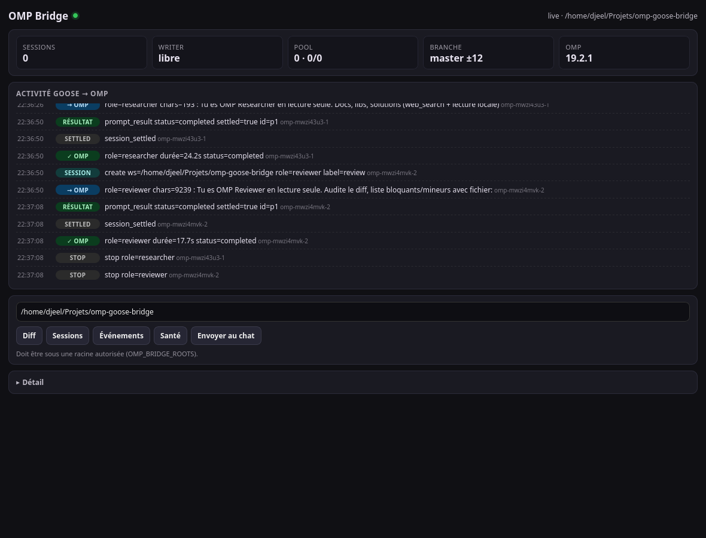

# OMP Bridge — Goose × OMP

Bridge **MCP** qui donne à [Goose](https://block.github.io/goose/) un moteur d'exécution externe (**OMP**) piloté en **RPC**, avec une règle dure : **un seul writer par workspace**.

Goose orchestre et décide ; OMP exécute dans des sessions isolées. Le bridge expose 19 outils MCP, un panneau de suivi (MCP App inline + page web locale), des recipes, des agents et des slash commands.

> **English TL;DR** — An MCP bridge that lets [Goose](https://block.github.io/goose/) delegate work to an external **OMP** engine over RPC, with a hard rule: **one writer per workspace** (read-only roles are enforced process-side). 19 MCP tools, inline MCP App panel, SQLite event log, recipes/agents, live panel (SSE), 77 tests, MIT. Full docs below are in French; see [`.env.example`](.env.example) for configuration.

```
Goose (Desktop / CLI)
   │  MCP stdio
   ▼
omp-bridge (ce repo)  ──HTTP 127.0.0.1:3210──►  panneau web (panel.html)
   │  RPC (JSON lines)
   ▼
OMP process (--mode rpc --no-ui)   × 1 par session
   │
   └─ workspace (git) : lecture seule par défaut, écriture sous verrou
```

## Modèle d'autorité

| Rôle | Accès | Verrou |
|---|---|---|
| `developer` | **seul writer** (`edit`/`write`/`bash`) | 1 par workspace |
| `architect` | lecture seule | — |
| `researcher` | lecture seule | — |
| `reviewer` | lecture seule (gate diff) | — |
| session `default` | lecture seule (`--no-tools`) | — |

Le verrou est **process-side** (`--no-tools --tools <whitelist>`), pas seulement une consigne de prompt. Une session `read-only` ne peut pas muter, même si le modèle le demande.

## Prérequis

- [Bun](https://bun.sh) ≥ 1.1
- Le binaire **OMP** dans le `PATH` (ou `OMP_BIN`), avec une clé API configurée
- [Goose](https://block.github.io/goose/) Desktop ou CLI

## Installation

```bash
git clone https://github.com/djeel/omp-goose-bridge.git
cd omp-goose-bridge
bun install

# Copie recipes + agents aux emplacements Goose, puis affiche le snippet d'extension
bun run install:goose
```

Puis ajoute l'extension à `~/.config/goose/config.yaml` :

```yaml
extensions:
  omp-bridge:
    enabled: true
    type: stdio
    name: OMP Bridge
    cmd: bun
    args: ["/chemin/absolu/omp-goose-bridge/src/mcp/server.ts"]
    envs:
      OMP_BRIDGE_WORKSPACE: "/chemin/vers/tes/projets"
      OMP_BRIDGE_ROOTS: "/chemin/vers/tes/projets:/tmp"
    timeout: 300
```

Redémarre Goose. Vérifie que les outils `omp_*` apparaissent.

> **Desktop Flatpak** : utilise `cmd: flatpak-spawn` et `args: ["--host", "bun", "/chemin/.../src/mcp/server.ts"]`.

## Panneau (activité live)



```bash
bun run panel     # http://127.0.0.1:3210/ (bind localhost uniquement)
```

Trois façons de voir ce que fait OMP, de la plus intégrée à la plus autonome :

| Où | Comment | Contenu |
|---|---|---|
| Chat Goose | outil `omp_dev_panel` → MCP App inline | timeline live + KPI + diff |
| Fenêtre Goose | sidebar **Apps** → *omp-dev-panel* (HTML importé) | même panneau, plein écran |
| Navigateur | `http://127.0.0.1:3210/` | même panneau, autonome |

**Ce que la timeline montre** (mise à jour en direct, sans bouton Refresh) :

```
22:36:50  ROUTE    delegate=true role=researcher (mot-clé recherche/docs)
22:36:50  SESSION  create ws=/projets/app role=researcher label=auto-researcher
22:36:50  → OMP    role=researcher chars=193 : Tu es OMP Researcher…
22:37:08  RÉSULTAT prompt_result status=completed settled=true
22:37:08  ✓ OMP    role=researcher durée=24.2s status=completed
22:37:08  STOP     stop role=researcher
```

KPI affichés : sessions vivantes, verrou writer, pool read-only (au repos · hits/misses), branche ±fichiers modifiés, version OMP.

- API lecture : `GET /activity?workspace=…` (snapshot JSON), `GET /stream` (SSE : `snapshot`, `event`, `ping`)
- API actions : `POST /mcp/{omp_dev_status,omp_get_diff,omp_sessions_list,omp_events_list}`
- Le panneau est amorcé côté serveur (snapshot SSR) puis suit le flux SSE : il est déjà rempli au premier rendu.

Les outils nécessitant le process OMP (`omp_auto`, `omp_review`, `omp_run_role`, `omp_session_prompt`) restent côté MCP.

## Outils MCP (19)

**Pilotage** : `omp_delegate`, `omp_status`, `omp_steer`, `omp_cancel`, `omp_agents_list`
**Preuves** : `omp_get_diff`, `omp_review`, `omp_dev_status`, `omp_events_list`, `omp_dev_panel`
**Diagnostic** : `omp_health` (version, binaire OMP, racines, verrou, sessions, DB)
**Routage** : `omp_auto` (décide seul : petit → Goose direct, sinon rôle OMP)
**Sessions** : `omp_run_role`, `omp_session_create|list|resume|new|stop|prompt`

`omp_auto`, `omp_run_role` et `omp_review` sont **éphémères** : la session OMP est arrêtée
après la réponse, ce qui libère le process et le verrou writer (`keep: true` pour conserver).
Un balayeur stoppe aussi toute session inactive au-delà de `OMP_BRIDGE_SESSION_TTL`.

## Recipes, agents, slash commands

```bash
/omp-auto corrige le bug du routeur      # CLI
/omp-review src/core/router.ts
/omp-develop ajoute la validation YAML
```

Agents (mention `@` dans Goose) : `omp-architect`, `omp-researcher`, `omp-developer`, `omp-reviewer`.

> Desktop n'auto-découvre pas les recipes du filesystem : importe-les depuis `~/.config/goose/recipes/` (Recipes → Import Recipe).

## Configuration

Tout est optionnel — voir [`.env.example`](.env.example).

| Variable | Défaut | Rôle |
|---|---|---|
| `OMP_BIN` | `omp` | binaire OMP |
| `OMP_BRIDGE_ROOTS` | `cwd:/tmp` (`:`) | racines autorisées |
| `OMP_BRIDGE_WORKSPACE` | `cwd` | workspace par défaut |
| `OMP_BRIDGE_DB` | `<repo>/data/bridge.db` | historique SQLite |
| `OMP_BRIDGE_HTTP` / `_HOST` | `3210` / `127.0.0.1` | panneau |
| `OMP_BRIDGE_SESSION_TTL` | `1800` | arrêt auto des sessions inactives (s) |
| `OMP_BRIDGE_PROMPT_TIMEOUT` | `300` | timeout d'un prompt (s) |
| `OMP_BRIDGE_MAX_OUTPUT` | `12000` | taille max d'une réponse (caractères) |
| `OMP_BRIDGE_EVENTS_MAX` | `20000` | rétention |
| `OMP_BRIDGE_TOKEN` | *(vide)* | token du panneau HTTP (`x-omp-bridge-token`) |
| `OMP_BRIDGE_SESSIONS_DIR` | `~/.local/share/omp-bridge/sessions` | reprise de session autorisée |
| `OMP_BRIDGE_VERBOSE` | `0` | logs stderr |

## Diagnostic & dépannage

```bash
curl -s http://127.0.0.1:3210/healthz | jq     # état complet (version, OMP, racines, sessions)
bun run probe                                  # handshake RPC réel
```

| Symptôme | Cause probable | Fix |
|---|---|---|
| `binaire OMP introuvable: "omp"` | OMP absent du `PATH` | `export OMP_BIN=/chemin/omp` |
| `workspace refusé: /x` | hors allowlist | ajouter `/x` à `OMP_BRIDGE_ROOTS` |
| `writer deja actif <id>` | session developer vivante | `omp_session_stop` ou attendre le TTL |
| panneau « injoignable » | serveur HTTP arrêté | `bun run panel` |
| `EADDRINUSE` | port 3210 pris | `OMP_BRIDGE_HTTP=3211` |
| MCP ne liste pas les outils | extension non activée | vérifier `enabled: true` puis redémarrer Goose |

## Sécurité

- Allowlist de workspaces (`OMP_BRIDGE_ROOTS`) — rejet hors racines, y compris évasion par préfixe.
- Écriture impossible hors session `developer`, verrou single-writer par workspace.
- Panneau HTTP **bind 127.0.0.1** par défaut (jamais exposé au LAN).
- Panneau : POST refusé si l'`Origin` n'est pas locale (anti-CSRF) et token optionnel comparé à temps constant.
- Résolution des symlinks sur le plus long préfixe existant (`/tmp/lien/x` → `/etc` refusé).
- Chemins de session (`session_dir`/`session_path`) validés contre l'allowlist.
- Aucun secret dans le repo ; stdout réservé au protocole MCP (logs sur stderr).

## Tests

```bash
bun run ci        # typecheck + lint + tests (ce que fait la CI)
bun run check     # tsc --noEmit
bun run lint      # biome lint .
bun test          # 77 tests : guard, router, events, status, HTTP, client RPC (fake OMP), rôles, pool, config
bun run bench     # micro-benchmarks des chemins chauds
bun run probe     # handshake RPC réel avec OMP
```

Le client RPC est testé sans binaire OMP via `tests/fixtures/fake-omp.ts`
(handshake, prompt, abort, crash, binaire absent).

Plus de détails : [ARCHITECTURE.md](ARCHITECTURE.md) · [CHANGELOG.md](CHANGELOG.md) ·
exemples dans [`examples/`](examples).

## Licence

MIT — voir [LICENSE](LICENSE).
